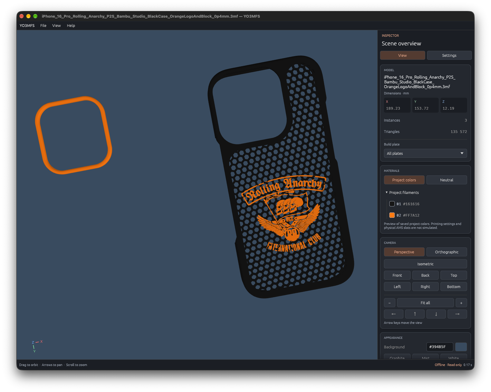

# YO3MFS

An offline desktop 3MF viewer written in Rust for **macOS, Windows, and Linux**, with support for Bambu Studio project colors and painted faces.

Open a file, inspect it from any angle, and choose a comfortable background. YO3MFS preserves the original file and does not require Bambu Studio, a printer connection, or an account.



**Current version: 1.3.1.** The application has been tested locally on Apple Silicon. All four native GitHub build jobs and release publication passed for [v1.3.1](https://github.com/mpakus/yo3mfs/actions/runs/39000331367). A successful build is separate from manual GUI acceptance; see [validation results and remaining checks](docs/VALIDATION.md).

## Download and run

Download **[YO3MFS v1.3.1](https://github.com/mpakus/yo3mfs/releases/tag/v1.3.1)** from GitHub Releases:

| Platform | Architecture | Download |
| --- | --- | --- |
| macOS | Apple Silicon / ARM64 | [DMG](https://github.com/mpakus/yo3mfs/releases/download/v1.3.1/yo3mfs-1.3.1-aarch64-apple-darwin.dmg) |
| macOS | Intel / x64 | [DMG](https://github.com/mpakus/yo3mfs/releases/download/v1.3.1/yo3mfs-1.3.1-x86_64-apple-darwin.dmg) |
| Windows | x64 | [Portable ZIP](https://github.com/mpakus/yo3mfs/releases/download/v1.3.1/yo3mfs-1.3.1-x86_64-pc-windows-msvc.zip) |
| Linux | x64, built on Ubuntu 24.04 | [Portable tar.gz](https://github.com/mpakus/yo3mfs/releases/download/v1.3.1/yo3mfs-1.3.1-x86_64-unknown-linux-gnu.tar.gz) |

[SHA-256 checksums](https://github.com/mpakus/yo3mfs/releases/download/v1.3.1/SHA256SUMS) · [Release notes](docs/releases/v1.3.1.md) · [Latest release](https://github.com/mpakus/yo3mfs/releases/latest) · [All releases](https://github.com/mpakus/yo3mfs/releases)

Version tags publish packages only after all four platforms pass their checks. Development builds remain available under [Actions](https://github.com/mpakus/yo3mfs/actions/workflows/ci.yml) for 14 days. Release assets are separate downloads and do not expire with Actions artifacts. See [build and release instructions](docs/GITHUB-ACTIONS.md).

On macOS, open the DMG and copy `yo3mfs.app` to Applications. On Windows, extract the ZIP and run `yo3mfs.exe`. On Linux, extract the archive and run `./yo3mfs`. Packages are not signed for public distribution: macOS uses an ad-hoc signature without Developer ID/notarization; Windows Authenticode signing is not configured. Linux archives do not bundle system libraries.

### macOS first launch

Version 1.3.1 is not notarized, so macOS may block it with an alert that Apple could not verify the app is free of malware. If you downloaded the package from this repository's Releases and trust this build:

1. Copy `yo3mfs.app` from the DMG into Applications and try opening that copy.
2. Choose **Done** when the warning appears.
3. Open **System Settings → Privacy & Security**, scroll to Security, and select **Open Anyway** for YO3MFS.
4. Confirm **Open** and authenticate if requested. macOS remembers the exception for this app.

See [Apple's instructions](https://support.apple.com/en-us/102445). This approves the current app locally; it does not notarize the release. Removing this verification warning for other users requires a future build signed with Developer ID and notarized by Apple.

The next macOS release workflow now includes [Developer ID signing and notarization](docs/MACOS-SIGNING.md), adapted from GitRonimo. It requires signing credentials and a successful new tagged build; the v1.3.1 downloads above remain unchanged.

### Run from source

To run from source, install Rust/rustup and your platform's build tools:

```bash
cargo run --locked --release
cargo run --locked --release -- "/path/to/model.3mf"
```

Rust **1.97.1** is pinned in `rust-toolchain.toml`; the project uses edition 2024. Use the project's own `tests/fixtures/sample.3mf` for a quick check.

## Features

- A compact text menu: YO3MFS / File / View / Help, with keyboard shortcuts.
- A system file picker, single-file drag-and-drop, and a command-line file argument.
- GPU rendering of meshes, multiple objects, shared instances, and nested components.
- Bambu filament colors, object/part assignments, and paint boundaries inside triangles.
- Materials → Project colors / Neutral, a numbered project palette, and a saved display mode.
- Full rotation, zoom, pan, and seven standard views.
- Perspective and orthographic projections, and Fit all.
- A background color picker, HEX input, and saved presets.
- English by default; the Russian option in Settings applies immediately and is saved.
- A graphite inspector with Model, Materials, Camera, Appearance, and Settings sections.
- YO3MFS → About, including [Made in Austin ✩ Texas](https://aomega.co/). Help contains Controls only.
- X/Y/Z dimensions in millimeters, instance counts, and original triangle counts.
- Background loading with stages and cancellation; a failed new load preserves the previous scene.
- Core 3MF, external Production parts, and basic Bambu part roles and plate selection.

The viewer works locally and never edits or uploads a 3MF. It does not slice, print, edit geometry, or export models. The application is written in Rust with a WGSL shader; it has no WebView or JavaScript frontend.

## Compatibility

Supported geometry includes meshes, build instances, component transforms, all six Core length units, and Production Extension references. Recognized Bambu plates can be selected, and helper parts are excluded with a warning. Unknown required extensions are rejected. Bambu colors and painting are displayed within the [documented profile](docs/BAMBU-COLORS.md).

Textures, standard Core/Materials color resources, physical AMS slots, multicolor filament effects, and print settings are not reproduced. Invalid optional painting falls back to a base material with a warning. Overlapping parts are rendered without a slicer's Boolean operations; coincident surfaces may show color flicker. A painting brush and export are not included in 1.3.

Five public files have been checked: two from the official Bambu Studio repository and three issue attachments. Their recorded exporter versions are **01.07.03.04, 01.07.03.50, 01.10.02.76, and 02.04.00.70**; one file has no exporter version. The corpus covers external model parts, part assignments, whole painted faces, and face subdivisions. This does not establish compatibility with every export from those or newer versions. Sources, SHA-256 hashes, and expected geometry are recorded in [external.json](tests/fixtures/external.json). External models are not bundled.

Files without usable geometry, including G-code-only 3MF files, receive an error. “Any 3MF” means a file can be selected and inspected; an unsupported format is not reported as successfully loaded.

## Controls

| Action | Control |
| --- | --- |
| Open | File → Open…; `⌘O` / `Ctrl+O` |
| Orbit | Left-button drag; `Alt` + arrows with viewport focus |
| Pan | Arrow keys; `Shift` + arrows for faster movement; middle-button or `Shift` + left-button drag |
| Zoom | Wheel/scroll, buttons, or `+` / `−` keys |
| Fit all | `F`, View → Fit all, or the inspector button |
| Reset view | `Home` or View → Reset view |
| Orientation / projection | View submenus or the right panel |
| Model colors | Materials → Project colors / Neutral |
| Background | Color picker, `#RRGGBB`, or presets |
| Settings and language | YO3MFS → Settings…; `⌘,` / `Ctrl+,`; Settings tab |
| About | YO3MFS → About YO3MFS |
| Cancel loading | Cancel or `Esc` |

Pinch is handled when the window system provides it. Click the viewport to enable camera keyboard controls; arrows in the HEX field, menus, or dialogs do not move the camera. Help → Controls or `F1` opens the control guide. `⌘W` / `Ctrl+W` closes the window; `⌘Q` / `Ctrl+Q` quits. The system file picker follows the operating system's language.

## Build and verify

```bash
cargo fmt --all -- --check
cargo clippy --locked --all-targets --all-features -- -D warnings
cargo test --locked --all-targets --all-features
cargo test --locked --no-default-features
cargo build --locked --release
python3 scripts/package.py --dmg  # macOS .app + .dmg
python3 scripts/package.py        # Windows ZIP / Linux tar.gz / macOS .app
```

Packaging requires Python 3.11 or newer; GitHub Actions installs Python 3.13. Core tests require neither a window nor a GPU. RTK is a local agent-tooling convention, not an application or CI dependency.

macOS requires Xcode Command Line Tools. Windows requires MSVC Build Tools and the Windows SDK. Ubuntu 24.04 build packages are listed in the [workflow](.github/workflows/ci.yml). Linux needs a working graphical backend, X11 or Wayland, and `xdg-desktop-portal` with the desktop's portal backend for the [rfd](https://github.com/PolyMeilex/rfd) file picker. A clean Linux installation still needs runtime testing. The tar.gz includes the binary, instructions, icon, desktop entry, and font license; it is not an AppImage.

```bash
# Optional: download and verify five pinned public reference models
python3 scripts/check_reference_models.py --download
# Generate a model with nearly one million triangles and measure headless import
python3 scripts/generate_benchmark.py
cargo run --locked --release --no-default-features --example inspect -- target/benchmark.3mf
```

ZIP/XML are streamed with limits, without extracting files or fetching external URIs. Settings are written atomically to the OS-specific user configuration directory. Format and memory limits are described in [SPEC.md](SPEC.md).

## Documentation

- [SPEC.md](SPEC.md) — requirements, architecture, limits, and acceptance criteria.
- [AGENTS.md](AGENTS.md) — development rules, including English documentation and both UI dictionaries.
- [GitHub Actions](docs/GITHUB-ACTIONS.md) — runners, build artifacts, version tags, and release publishing.
- [Bambu colors](docs/BAMBU-COLORS.md) — painting format and compatibility profile.
- [Validation](docs/VALIDATION.md) — evidence and remaining checks.
- [Implementation plan](tasks/plan.md) and [task status](tasks/todo.md).

YO3MFS is independent and is not an official Bambu Lab product. A project license has not yet been selected; publishing downloads does not grant an open-source license. License selection and dependency-license review remain outstanding. Private user models are never added to the repository automatically.

## Logo and icons

The approved mark appears in the empty window, About, and OS application resources. [PNG, ICNS, ICO, and prompts](assets/branding/README.md) are retained in the repository; graphics are embedded in the executable. The macOS bundle contains ICNS, the Windows EXE embeds ICO through `build.rs`, and the Linux package contains PNG and a desktop entry. The menu is an in-window egui MenuBar; the OS window frame is native, but integration with the global macOS menu bar is not implemented.

### Linux application menu icon

From the extracted tar.gz, install the binary and launcher for the current user:

```bash
install -Dm755 yo3mfs "$HOME/.local/bin/yo3mfs"
install -Dm644 share/applications/com.yo3mfs.viewer.desktop "$HOME/.local/share/applications/com.yo3mfs.viewer.desktop"
install -Dm644 share/icons/hicolor/512x512/apps/com.yo3mfs.viewer.png "$HOME/.local/share/icons/hicolor/512x512/apps/com.yo3mfs.viewer.png"
```

`$HOME/.local/bin` must be in the graphical session's PATH. The app ID matches the desktop entry so Wayland can associate the window with its icon. Installation does not change 3MF file associations. Native Linux verification remains part of platform acceptance.
