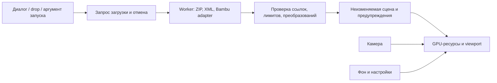

# yo3mfs — спецификация десктопного просмотрщика 3MF

**Статус:** контракт v1.2.0; реализация и локальная macOS-сборка готовы. Полная приёмка всех платформ и публичный выпуск ещё не завершены. Фактические доказательства — [docs/VALIDATION.md](docs/VALIDATION.md).

**Дата:** 16 октября 2026 года.

**Рабочее название:** yo3mfs.

## 1. Назначение

Создать приложение на Rust для macOS, Linux и Windows, в котором пользователь открывает 3MF и сразу осматривает трёхмерную модель. Основной источник файлов — Bambu Studio; установленный Bambu Studio для просмотра не требуется.

Успешный сценарий: перетащить `.3mf` в окно → увидеть целую сцену → повернуть её к нужной стороне → приблизить деталь → выбрать удобный фон. Исходный файл остаётся неизменным.

### Подтверждённые требования

1. Десктопное приложение для Apple/macOS, Linux и Windows.
2. Основной язык реализации — Rust.
3. Открытие 3MF через диалог и перетаскивание.
4. Просмотр модели со всех сторон, вращение, увеличение и уменьшение.
5. Изменение общего цвета фона области просмотра.

### Принятые допущения

- Приложение самостоятельное, офлайн, без аккаунтов и подключения к принтеру.
- «Во всех измерениях» означает свободный осмотр геометрии и виды по осям X/Y/Z. Сечения и просмотр слоёв печати требуют отдельного расширения задачи.
- В одном окне открыт один документ; открытие другого файла заменяет его только после успешной загрузки.
- Для первой версии важна геометрия; исходная раскраска и текстуры могут отображаться упрощённо с предупреждением.
- Интерфейс по умолчанию — английский. В Settings пользователь переключает English / Русский; выбор сохраняется между запусками. Код и идентификаторы — английские. Оба словаря поддерживаются одновременно, включая ошибки и предупреждения.

Эти границы использованы в реализации v1; изменения отражаются в спецификации.

## 2. Объём первой версии

Включены импорт геометрии 3MF, интерактивная камера, базовые виды и проекции, фон, минимальная информация о сцене, сообщения о ходе загрузки и ошибках, локальное сохранение настроек.

За пределами первой версии: нарезка, G-code preview, печать, редактирование и ремонт сетки, экспорт 3MF/STL, сечения, точечные измерения, фотореалистичные материалы, точное воспроизведение Bambu painting/AMS, облако, телеметрия, автоматические обновления, плагины, ассоциация файлов в ОС и системные Quick Look/Explorer previews.

Размеры X/Y/Z — габариты всей отображаемой сцены, а не инструмент измерения расстояния между выбранными точками.

## 3. Платформы и распространение

| Платформа | Целевые архитектуры первой версии | Предложение по дистрибутиву |
| --- | --- | --- |
| macOS | Apple Silicon `aarch64`, Intel `x86_64` | `.app` в `.dmg`; отдельные сборки либо universal после проверки |
| Windows | `x86_64`, Windows 11 | Portable ZIP с `.exe` |
| Linux | `x86_64`; Ubuntu 24.04 LTS как первая проверяемая база | Portable tar.gz; проверка X11 и Wayland |

Минимальная версия macOS, совместимость с другими Linux-дистрибутивами и Windows 10 определяются после проверки выбранных библиотек и реальных сборок. Windows ARM64 и Linux ARM64 пока не обещаны. Поддержка macOS Intel остаётся отдельным обязательным пунктом проверки, а не следствием успешной сборки на Apple Silicon.

Системные библиотеки, графические драйверы и Linux file-dialog portal нужно проверить на чистой системе и перечислить в инструкциях установки. Упаковка реализована в `scripts/package.py`: `.app`/`.dmg`, Windows ZIP, Linux tar.gz. Для первого локального результата выбран tar.gz с явными системными зависимостями; первоначальное предложение AppImage остаётся следующим этапом проверки переносимости. Это не снимает поддержку Linux. Для публичной поставки macOS нужны проверка подписи/notarization и процедура Gatekeeper; Windows-дистрибутив также проверяется на чистой машине с документированным статусом подписи. Внутренняя unsigned-сборка не считается готовым публичным релизом.

## 4. Функциональные требования

### FR-01. Открытие документа

- Кнопка в пустом окне, пункт меню «Файл → Открыть» и `⌘O` / `Ctrl+O` вызывают системный диалог с фильтром `.3mf` без учёта регистра.
- Один файл можно перетащить в любую свободную область главного окна. При наведении показывается подсказка «Отпустите, чтобы открыть 3MF».
- Путь к одному файлу можно передать при запуске: `yo3mfs "/path/to/model.3mf"`.
- Отмена диалога ничего не меняет. Пустой путь, директория, недоступный файл и неверный формат получают понятное сообщение.
- Одновременное перетаскивание нескольких файлов отклоняется с подсказкой «Откройте один 3MF-файл»; порядок файлов не определяет выбор молча.
- Поддерживаются пробелы и кириллица в путях. Внутренние пути ОС хранятся в `PathBuf`/`OsString`, без обязательного преобразования в UTF-8.
- Расширение служит подсказкой; формат проверяется по содержимому.

### FR-02. Загрузка и замена сцены

- Состояния: пустое окно, загрузка, готовая сцена, готовая сцена с предупреждениями, ошибка.
- UI остаётся отзывчивым; доступны текущая стадия («Чтение архива», «Разбор модели», «Подготовка сцены») и отмена. Процент показывается только при известном объёме работы.
- При первом открытии сцена автоматически вписывается в окно в изометрии.
- Пока загружается новый файл, предыдущая сцена сохраняется. Ошибка или отмена возвращает к ней; при отсутствии сцены остаётся пустое окно с сообщением.
- Если пользователь открывает B во время загрузки A, A отменяется. Только последний актуальный запрос может заменить сцену; одновременно допускается не более одной тяжёлой загрузки.
- Подготовленные ресурсы нового документа заменяют старые атомарно после успешной загрузки, включая создание GPU-буферов. Учитывается память обеих сцен.

### FR-03. Камера

- Вращение вокруг центра сцены на 360° с возможностью осмотреть верх и низ; перемещается камера, а не геометрия документа.
- Масштабирование плавное, с ограничениями, исключающими пересечение точки фокуса и некорректные значения матрицы.
- Перемещение вида доступно мышью и без средней кнопки.
- «Показать всё» вписывает сцену, сохраняя направление камеры. «Сбросить вид» возвращает начальную изометрию, перспективу и полный охват.
- Есть шесть ортогональных видов и изометрия, переключатель «Перспектива / Ортографическая».
- Размер viewport, DPI и изменение окна учитываются при вычислении проекции и ввода. Нулевой размер окна, сворачивание и пустая сцена обрабатываются без деления на ноль.

| Действие | Основное управление | Альтернатива |
| --- | --- | --- |
| Вращение | Левая кнопка + движение | Перетаскивание на трекпаде; `Alt` + стрелки при фокусе viewport |
| Перемещение | Средняя кнопка + движение | `Shift` + левая кнопка; стрелки, `Shift` + стрелки — быстрее |
| Масштаб | Колесо / прокрутка двумя пальцами | Кнопки и клавиши `+` / `−`; pinch при доступности события |
| Показать всё | `F` | Кнопка |
| Сброс вида | `Home` | Кнопка |
| Стандартный вид / проекция | Панель видов | Выбор с клавиатуры через фокус |

Pinch не является единственным способом масштабирования. Жесты проверяются отдельно на macOS, Windows и Linux; UI не должен требовать трёхкнопочную мышь. Камера реагирует на ввод только внутри viewport; ввод в поле цвета, диалог или меню не вращает модель. `Esc` сначала закрывает активный popup, затем отменяет загрузку.

### FR-04. Отображение геометрии

- Используются depth buffer, простое освещение и нейтральный непрозрачный материал. Контуры формы должны читаться при вращении.
- Сохраняются расположение, масштаб, поворот и отражения всех экземпляров; не выполняются автоматический ремонт, разрезание или укладка на стол.
- Внутренняя система координат — правосторонняя, Z вверх; размеры приводятся к миллиметрам. Преобразование для GPU изолировано и проверяется тестом ориентации.
- Габариты вычисляются после всех преобразований. `Fit all` учитывает все отображаемые экземпляры и адаптивные near/far planes.
- Общий mesh нескольких экземпляров не копируется без необходимости. Пересчёт нормалей учитывает неравномерный масштаб; отражения не должны делать объект невидимым из-за winding/culling.
- Оси X/Y/Z и небольшая легенда доступны как ориентир. Печатный стол конкретной модели принтера не требуется.
- Отображаемая сцена не подменяется встроенной PNG-миниатюрой.

### FR-05. Цвет фона и настройки

- Кнопка «Фон» открывает палитру, поле `#RRGGBB` и пресеты: тёмный `#20242B`, светлый `#F2F4F7`, белый `#FFFFFF`. По умолчанию — тёмный.
- Изменение применяется сразу ко всей области 3D-просмотра. Прозрачность и градиенты в первой версии не нужны.
- Неверный HEX получает inline-ошибку; последний корректный цвет сохраняется. Есть команда «Вернуть фон по умолчанию».
- Фон не меняет цвета геометрии и тему панелей интерфейса. Цвета UI, осей и подписи сохраняют читаемость при светлом и тёмном фоне.
- Выбор фона сохраняется между запусками в пользовательской директории настроек ОС. Настройки имеют версию схемы и записываются атомарно.
- Повреждённые настройки заменяются безопасными значениями с уведомлением. Ошибка записи не мешает просмотру: «Фон изменён, но настройку не удалось сохранить».
- Путь к последней модели и содержимое модели по умолчанию не сохраняются.

### FR-06. Информация и сообщения

- Показываются имя файла, число отображаемых экземпляров и треугольников с учётом экземпляров, габариты X/Y/Z в мм.
- Предупреждения доступны после загрузки, а не исчезают только в коротком toast.
- Ошибки различают: доступ к файлу, повреждённый ZIP/XML, отсутствие геометрии, неподдерживаемое расширение, превышение лимита и невозможность GPU-рендеринга.
- Сообщение содержит причину и доступное действие: открыть другой файл, отменить, повторить или посмотреть детали.
- При отсутствии рабочего GPU backend приложение показывает диагностику доступными средствами ОС и завершается корректно; программный рендерер в первой версии не обещан.
- При потере поверхности `eframe/egui-wgpu` пытается пересоздать её; CPU-сцена сохраняется. При потере самого GPU device или необработанной ошибке рендеринга приложение показывает системное сообщение и запрашивает закрытие с рекомендацией перезапуска. Автоматическое пересоздание device и восстановление сцены после него в v1 не реализовано. Файл на диске не меняется; искусственная потеря device ещё не проверена.

## 5. Совместимость с 3MF и Bambu Studio

«Открыть любой 3MF» означает принимать файл от любого производителя и определять его содержимое. Обещать полную визуальную поддержку всех существующих и будущих расширений нельзя: ниже зафиксирован проверяемый профиль первой версии.

### 5.1. Профиль импорта

3MF использует пакет с XML-частями, ресурсами и build items. Основой служат [3MF Core](https://github.com/3MFConsortium/spec_core/blob/master/3MF%20Core%20Specification.md) и [Production Extension](https://github.com/3MFConsortium/spec_production/blob/master/3MF%20Production%20Extension.md).

| Содержимое | Требуемое поведение первой версии |
| --- | --- |
| Core mesh: vertices/triangles | Прочитать и проверить индексы и конечность координат |
| Build items, components, transforms | Восстановить все экземпляры корневого build с правильным порядком преобразований |
| Единицы | Учесть micron, millimeter, centimeter, inch, foot, meter; при отсутствии — millimeter |
| Несколько model parts | Разрешать OPC relationships и Production `path`; object ID локален для соответствующей части |
| Повторные ссылки на mesh | Разделять геометрию и экземпляры |
| Неиспользуемые ресурсы | Не добавлять на сцену только потому, что они присутствуют в архиве |
| Core base materials / необязательные цвета и текстуры | Геометрия нейтральная; постоянное предупреждение об упрощённом отображении |
| Неизвестное обязательное расширение | Отклонить документ с названием/namespace расширения |
| Неизвестное необязательное расширение | Если Core-геометрия доступна и корректна — показать с предупреждением о возможном отличии |
| Пустой build или отсутствие пригодной геометрии | Сообщить об отсутствии геометрии, не выдавать thumbnail за модель |
| Повреждённая структура или обязательная ссылка | Отклонить импорт целиком; не показывать молча неполную сцену |

Корневая модель определяется по relationships, а не имени файла. Build-секции дочерних частей не добавляются как самостоятельные сцены. Namespace разбирается по URI, а не конкретному префиксу. Порядок матриц, соглашение о строках/столбцах и смена единиц между частями закрепляются числовыми тестами. Это требования нашего импортера на основе указанных спецификаций; заявление о полной сертификации 3MF не делается.

### 5.2. Особенности Bambu

В [исходниках Bambu Studio](https://github.com/bambulab/BambuStudio/blob/master/src/libslic3r/Format/bbs_3mf.cpp) присутствуют собственные части, в частности `Metadata/model_settings.config`, `Metadata/project_settings.config` и `Metadata/slice_info.config`. Это ориентир для совместимости, а не стабильный публичный API.

- Импорт стандартной геометрии не должен зависеть от наличия необязательных Bambu-настроек.
- Адаптер Bambu выделяется отдельно; при распознанных метаданных он определяет роли частей, чтобы negative volumes, modifiers и служебная геометрия не выглядели как обычные печатаемые детали.
- Для известных непечатных ролей допустимо исключение из основного вида с явным числом исключённых частей и предупреждением. Часть с неизвестной ролью остаётся видимой; предупреждение перечисляет такие части и объясняет, что они могут быть служебными. Такой документ нельзя помечать как полностью поддержанный.
- Boolean-результат вычитания negative volumes в первой версии не рассчитывается. При их наличии постоянно показывается «Показана исходная геометрия; вычитания не применены». Такой файл считается частично поддержанным.
- Если принадлежность к plate распознана однозначно, доступен выбор «Все / Пластина N». Иначе показывается сцена в исходных координатах с предупреждением, без догадок о распределении по пластинам.
- Для `.gcode.3mf` с доступной геометрией применяется обычный импорт; при наличии только траекторий выводится «Файл содержит данные печати без 3D-геометрии. Просмотр слоёв пока не поддерживается».
- Точное отображение окраски граней, filament/AMS assignments и внешнего вида печати не входит в первую версию. Отсутствие такой поддержки явно сообщается.

Поддержка Bambu подтверждается корпусом файлов с записанной версией экспортировавшего Bambu Studio. Проверен `pa_pattern.3mf` с метаданными BambuStudio-01.07.03.04 и калибровочный Core-файл без версии экспортера из официального репозитория. Источники, SHA-256 и результаты находятся в `tests/fixtures/external.json` и `docs/VALIDATION.md`; это покрытие отдельных файлов, а не сертификация версии приложения. Файл с новым вариантом формата сначала становится воспроизводимым тестом, затем расширяет матрицу совместимости.

## 6. Ограничения и безопасная загрузка

Чтение только локальное. Внешние ссылки, встроенный G-code и содержимое метаданных не выполняются. DTD и внешние XML-сущности отключены; архив не извлекается в файловую систему.

Следующие ограничения реализованы; их достаточность для крупных реальных моделей продолжает проверяться:

| Ресурс | Начальный предел |
| --- | --- |
| Размер входного файла | 512 MiB |
| Число ZIP entries | 10 000; EOCD/ZIP64 проверяется до построения индекса |
| ZIP central directory | 64 MiB и оценка памяти в пределах общего бюджета |
| Сумма распакованных байтов фактически читаемых частей | 2 GiB |
| Один XML model part | 512 MiB распакованных данных |
| Глубина XML / компонентов | 128 / 64 |
| Один XML token | до 1 MiB, с уменьшением при малом бюджете |
| Атрибуты / namespace bindings | 64 на элемент / 64 активных binding |
| Значение атрибута / URI namespace | 64 KiB / 2 KiB |
| Сумма треугольников уникальных mesh | 5 000 000 |
| Треугольники с учётом экземпляров | 10 000 000 |
| Число экземпляров | 100 000 |
| Учитываемые CPU/GPU-буферы импорта и обеих сцен вместе | 2 GiB; GPU-лимиты могут потребовать меньшего значения |

Для учитываемых структур пределы проверяются до выделения памяти и во время потокового чтения; арифметика бюджетов использует checked/saturating операции. Бюджет — консервативная оценка буферов и структур, а не жёсткий OS RSS limit: накладные расходы драйвера, runtime и аллокатора требуют отдельного измерения. Ограничение распакованных байтов не разрешает одновременно держать весь XML в памяти. При невозможности уложиться в бюджет импорт прекращается с названием лимита; ухудшать геометрию без уведомления нельзя.

Нормализуются пути внутри пакета; переход за корень, внешние URI и неоднозначные дубликаты частей отклоняются. Начальный `/` в OPC URI означает корень пакета, а не абсолютный путь ОС. Проверяются CRC читаемых ZIP entries, ссылки, циклы, индексы, `NaN`/`Infinity` и переполнение размеров. Вырожденные треугольники могут быть пропущены только с числом пропусков; если пригодных граней нет, импорт завершается ошибкой.

Отмена проверяется между порциями чтения, разбора и подготовки геометрии. Нет обещания мгновенной отмены блокирующего вызова ОС, но после его возврата устаревшая задача обязана завершиться без публикации результата.

## 7. Архитектура

### Решение D-001: Rust UI и собственная область 3D

**Статус:** принято и реализовано, 16 октября 2026 года.

Нужны три настольные платформы, системный диалог, mouse/trackpad input и GPU-просмотр mesh. Используется `egui/eframe` для окна и интерфейса, `wgpu` для 3D через интеграцию `egui-wgpu`. [eframe](https://docs.rs/eframe/latest/eframe/) предоставляет desktop framework; [wgpu](https://wgpu.rs/) — переносимый графический слой. Native file dialogs предлагает [rfd](https://github.com/PolyMeilex/rfd).

Причины: основной код остаётся на Rust, UI и viewport используют одну графическую интеграцию, для одного просмотрщика не требуется отдельный веб-фронтенд. Цена выбора: камера, scene graph, материалы и обработка формата реализуются нами; системный внешний вид и доступность элементов нужно проверять, а не предполагать.

Рассмотренные альтернативы: Tauri добавляет веб-стек; Bevy полезен для более сложных интерактивных сцен, но приносит дополнительную модель приложения; lib3mf может расширить поддержку формата, но добавляет нативную библиотеку и вопросы сборки/FFI. Эти варианты не исключены навсегда; замена основы требует обновить решение и проверить последствия для трёх платформ.

| Область | Библиотека / подход |
| --- | --- |
| Язык | Rust stable, edition 2024 |
| Окно и UI | `eframe`, `egui`, совместимый `egui-wgpu` |
| Рендерер | `wgpu`, WGSL, depth buffer; ресурсы общего device |
| Математика | `glam`; точность импорта выбирается с учётом преобразований и масштаба |
| Контейнер и XML | `zip` и потоковый [quick-xml](https://github.com/tafia/quick-xml) |
| Диалог открытия | `rfd` |
| Настройки | `serde`, `serde_json`, системная директория через `directories` |
| Ошибки | `thiserror`; предупреждения отдельно от фатальных ошибок |
| Фоновая работа | Один worker и ограниченные каналы; async runtime пока не требуется |

Проверенный toolchain и консервативно заявленный MSRV — Rust 1.97.1. Основные версии: eframe/egui 0.37.0, wgpu 30.0.1 через eframe, glam 0.34.1, zip 9.0.4, quick-xml 0.42, rfd 0.17.2. Полные версии закреплены в Cargo.lock. Один wgpu device используется UI и 3D viewport; Depth32Float, MSAA 4×, индексированные mesh и GPU instancing.

Импорт и композиция преобразований используют f64. Перед f32 GPU-буферами вычитается локальный центр mesh и нормализуется мировая сцена, чтобы сохранять точность модели далеко от начала координат. Габариты и статистика по пластинам кэшируются при импорте, не пересчитываются каждый кадр.

### Поток данных



`Scene` владеет уникальными mesh и экземплярами с мировыми преобразованиями. Камера и фон находятся вне сцены. `Result<Scene, ImportError>` возвращает сцену с предупреждениями; фатальная ошибка не содержит «успешной» частичной сцены. Идентичность ресурса — пара `(model_part, object_id)`, а не глобальный XML ID.

### Структура реализации

```text
Cargo.toml / Cargo.lock / rust-toolchain.toml
src/
  main.rs                 # запуск и аргумент пути
  lib.rs                  # тестируемые модули
  app.rs                  # окно, события и состояния загрузки
  import/                 # ZIP, OPC, XML, валидация
    bambu.rs              # Bambu metadata и роли частей
  scene.rs                # mesh, экземпляры, габариты
  camera.rs               # orbit, pan, zoom, проекции
  renderer.rs             # GPU-ресурсы и отрисовка
  settings.rs             # фон, язык, чтение и запись настроек
  i18n/                   # исчерпывающие словари English / Русский
  app/                    # инспектор, настройки, About и тема
  loader.rs               # один отменяемый worker
  prepared.rs             # подготовка f32 геометрии вне UI
assets/shaders/           # WGSL
tests/
  import_3mf.rs
  fixtures/               # небольшие модели и manifest происхождения
docs/VALIDATION.md        # результаты и оставшаяся приёмка
scripts/                  # упаковка и воспроизводимые проверки
.github/workflows/ci.yml  # четыре нативных runner-конфигурации
SPEC.md / AGENTS.md / README.md
```

Один Cargo-пакет достаточен для начала. Подключение GUI не должно быть обязательным для логических тестов importer/camera.

### Стиль и ошибки

`rustfmt`, английские идентификаторы, небольшие модули с ясным владением данными. На входных данных не используются panic/unwrap. Основные варианты существующего `ImportError` (остальные — в `src/import/mod.rs`):

```rust
#[derive(Debug, thiserror::Error)]
pub enum ImportError {
    #[error("Не поддерживается обязательное расширение: {0}")]
    Unsupported(String),
    #[error("Превышен лимит: {0}")]
    Limit(&'static str),
}
```

UI переводит тип ошибки в понятное сообщение. Техническая причина ZIP/IO/GPU добавляется к пользовательскому объяснению в сообщении об ошибке.

## 8. Производительность и удобство

- Разбор не блокирует UI; индикатор загрузки появляется не позже 100 мс после принятия запроса при нормальном состоянии ОС.
- Цель для release-сборки: готовый первый кадр за ≤ 5 с для локального файла до 100 MiB и 1 млн треугольников с учётом экземпляров; p95 времени кадра ≤ 33,3 мс при непрерывном вращении в viewport 1920×1080.
- Измерение: три открытия после запуска процесса и 30 секунд вращения; записываются файл/SHA-256, CPU/GPU/RAM, ОС, backend, DPI, время и пиковая память. Первый запуск шейдеров фиксируется отдельно.
- До утверждения эталонного оборудования на каждой ОС эти числа являются целями, а не подтверждёнными гарантиями. Изменение целей требует причины и обновления этой спецификации.
- В покое нет постоянной перерисовки; кадры запрашиваются при вводе, изменении окна или загрузке.
- Все основные действия доступны с клавиатуры, фокус виден, иконки имеют текстовые подписи или подсказки. Корректность кириллицы и масштабов интерфейса 100%/150%/200% проверяется вручную.
- Стандартный размер окна — 1280×800 логических пикселей, минимальная поддерживаемая область — 800×600; если экран меньше, окно помещается в доступную рабочую область.

## 9. Проверки и критерии приёмки

Для логики применяются обычные Rust unit/integration tests. GUI и GPU требуют отдельных проверок. Процент покрытия не заменяет перечисленные сценарии.

| ID | Проверяемый результат | Проверка |
| --- | --- | --- |
| AC-01 | Один и тот же 3MF открывается диалогом, drop и аргументом пути | Ручная проверка всех трёх ОС; Unicode/пробелы в пути |
| AC-02 | Обычная модель сразу видна целиком, может быть осмотрена с шести сторон | UI + тесты fit/projection/resize |
| AC-03 | Pan/zoom/orbit работают мышью, трекпадом и клавиатурой без перехвата ввода полей | Ручная проверка, включая Linux X11/Wayland |
| AC-04 | Габариты и экземпляры совпадают с ожидаемыми для units, nested transforms и Production parts | Числовые fixtures, включая поворот, отражение и неравномерный масштаб |
| AC-05 | Фон сразу меняется и сохраняется после перезапуска; неверный HEX и ошибка записи обработаны | Settings tests + UI |
| AC-06 | Подтверждённые Bambu-файлы читаются; modifiers/plates и упрощения имеют явный статус | Корпус с версиями, сравнение с Bambu Studio |
| AC-07 | Ошибочные архивы и превышение лимитов дают контролируемую ошибку, не crash | Негативные fixtures; измерение памяти на граничных примерах |
| AC-08 | Отмена и открытие B во время A не публикуют устаревшую сцену; при ошибке B остаётся предыдущая | Детерминированные тесты загрузчика + UI |
| AC-09 | Исходный файл не изменён и не отправлен в сеть | SHA-256 до/после, проверка поведения офлайн и отсутствия сетевой активности |
| AC-10 | UI отзывчив, показатели производительности измерены по протоколу | Release benchmark с указанным оборудованием |
| AC-11 | Приложение работает без установленного Bambu Studio на всех целевых архитектурах | Запуск упакованных сборок на чистых системах |
| AC-12 | README отличает проверенные возможности от ограничений | Сверка документации с отчётом приёмки |

Обязательные образцы: минимальная сетка; несколько объектов; повторные экземпляры; вложенные компоненты; model parts с одинаковыми локальными ID; все единицы; отрицательный determinant; пустой build; битая ссылка; цикл; некорректный индекс; `NaN`; усечённый ZIP/XML; traversal/external URI; чрезмерное сжатие, глубина и число экземпляров; неизвестные required/recommended extensions; цветная модель; несколько Bambu plates; negative volume/modifier; `.gcode.3mf` без mesh.

Fixtures создаются синтетически либо берутся с разрешением. Для каждого внешнего файла фиксируются источник, лицензия/разрешение, версия Bambu Studio, SHA-256, ожидаемые объекты и габариты. Большие архивы генерируются тестом или хранятся отдельно по описанному способу получения. Никакой пользовательский приватный файл не публикуется автоматически.

Для сравнения геометрии используются известные числовые значения; допустимая погрешность координат после импорта — `max(0,001 мм, 1e-5 × диагональ сцены)`. Визуальное сравнение служит дополнительной проверкой и не заменяет числовую.

## 10. Команды разработки

Из корня Cargo-проекта:

```bash
cargo run --locked
cargo run --locked -- "/path/to/model.3mf"
cargo fmt --all -- --check
cargo clippy --locked --all-targets --all-features -- -D warnings
cargo test --locked --all-targets --all-features
cargo build --locked --release
```

Команды должны выполняться в нативной CI-матрице macOS/Windows/Linux. В текущей агентской среде перед ними используется `rtk`. Локальные результаты этих команд приведены в отчёте проверки. Упаковка и системные зависимости описаны в README; CI workflow создан, но удалённые прогоны ещё не выполнены.

## 11. Правила изменений и готовность

**Всегда:** сохранять исходные файлы, валидировать входные данные, поддерживать отзывчивый UI, отражать фактическую совместимость в документации, выполнять проверки по масштабу изменения.

**Отдельное решение владельца:** изменение платформ или пользовательского контракта, добавление записи в 3MF/сетевых функций, существенная смена стека, лицензия и публичное распространение. Обычные обратимые действия в пределах уже порученной работы не требуют повторного разрешения.

**Никогда:** молча подменять модель картинкой, объявлять неполный импорт полным, менять исходный 3MF, исполнять содержимое архива, скрывать проваленные проверки или заявлять непроверенную поддержку ОС.

Первая версия готова после выполнения AC-01…AC-12, проверки дистрибутивов на заявленных архитектурах, фиксации известных ограничений и выбора лицензии. Текущий локальный результат и незакрытые пункты перечислены в `docs/VALIDATION.md`; реализация не выдаётся за завершённый публичный релиз всех платформ.

## 12. Решения, которые ещё предстоит зафиксировать

Перед публичным выпуском остаются:

- Лицензия, подпись/notarization и проверка дистрибутивов на чистых ОС.
- Минимальная проверенная macOS, Windows/Linux runtime, Intel Mac, X11/Wayland и trackpad/DPI.
- Расширенный корпус современных Bambu Studio проектов: несколько пластин, цветная геометрия, modifiers и большие файлы.
- Эталонное оборудование и полный протокол FPS/первого кадра; headless-замер не заменяет его.
- Проверка аварийного GPU-сценария и дальнейшее автоматическое восстановление device.

Поручение реализовать v1 получено; код, тесты и локальная упаковка созданы. Публикация и выбор лицензии не выполнялись.

## Изменения интерфейса 1.1

- Инспектор справа: графитовые поверхности, тонкие границы, тёплый акцент; вкладки View и Settings. Модель, размеры по осям, статистика, ракурсы, проекция, навигация и фон сгруппированы в компактные секции. Панель прокручивается при небольшой высоте окна.
- Стрелки перемещают вид в направлении экрана без изменения ориентации. Шаг — 24 логических пикселя, Shift увеличивает его в 4 раза; Alt + стрелки вращает. Управление активно после клика в область модели; поля ввода, всплывающие меню и окна Help/About его блокируют.
- Язык применяется немедленно, включая открытые сообщения. Отсутствие `language` в старых настройках означает English и не сбрасывает фон. Неизвестный язык также получает English. Ошибки ОС и сторонних библиотек могут сохранять исходный технический текст.
- About показывает версию сборки, назначение приложения и кликабельную ссылку [Made in Austin ✩ Texas](https://aomega.co/) с неизменным текстом в обоих языках. Сеть используется только по явному клику пользователя на эту ссылку в системном браузере.

## Изменения 1.2 — меню и брендинг

Верхние отдельные кнопки заменены компактной строкой текстового меню `YO3MFS / File / View / Help` (русские пункты: `YO3MFS / Файл / Вид / Справка`). Используется egui MenuBar внутри окна; нативная рамка ОС сохранена. Глобальное системное меню macOS не входит в эту реализацию.

- YO3MFS: About, Settings (`⌘,` / `Ctrl+,`), выход (`⌘Q` / `Ctrl+Q`).
- File: Open (`⌘O` / `Ctrl+O`), закрытие окна (`⌘W` / `Ctrl+W`).
- View: Fit all, Reset view, Zoom in/out, Orientation, Projection. Команды камеры недоступны без сцены; выбранные ракурс и проекция отмечены.
- Help: Controls (`F1`), About. Открытое меню не передаёт стрелки в камеру.
- Рядом с командами отображаются сочетания клавиш в обозначениях текущей ОС.

Логотип и иконка утверждены владельцем 16 октября 2026 года. Обзорный макет сохранён в `assets/branding/concepts/`, рабочие файлы и промпты — в `assets/branding/`. Медная Y на графитовом кубе используется в пустом окне и в иконке приложения; светлый логотип — в About. Графика встроена в бинарник и не требует сети или файлов рядом с приложением. Иконки ОС: macOS ICNS в bundle, Windows ICO в ресурсе EXE, Linux PNG и desktop entry с совпадающим app_id `com.yo3mfs.viewer`. Linux desktop entry устанавливается пользователем отдельно; системные ассоциации 3MF не меняются.
