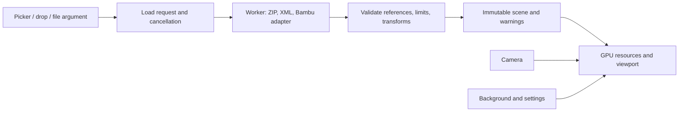

# YO3MFS — desktop 3MF viewer specification

**Status:** v1.3.0 contract; implementation and local macOS builds are available. Full platform acceptance and public distribution are not complete. Evidence is recorded in [docs/VALIDATION.md](docs/VALIDATION.md).

**Date:** October 16, 2026. **Product name:** YO3MFS.

## Version 1.3 contract — Bambu Studio colors

The owner's request adds viewing of existing Bambu Studio painting. The application remains a viewer: no brush, paint editing, or writes to 3MF.

- Read colors from `filament_colour` in `Metadata/project_settings.config`, and object/part `extruder` assignments from `Metadata/model_settings.config`.
- `paint_color` overrides the part color; state 0 inherits the part/object color. Support whole faces and triangle subdivisions, including extended filament numbers.
- Preserve original coordinates, source face counts, dimensions, instances, and plate selection. Additional triangles are used only to render paint boundaries.
- The inspector offers Project colors / Neutral and a numbered filament palette with HEX values. Save the mode; old settings receive Project colors without resetting language/background. Add every new string to EN/RU together.
- Invalid optional painting must not hide geometry: use the base/neutral material and a persistent warning. Exceeding memory, depth, or rendered-triangle limits stops loading and preserves the last scene.
- Limits: project JSON up to 8 MiB within the shared budget; up to 256 colors; paint-tree depth up to 64. Subdivided geometry and its instances count toward the 10-million rendered-triangle and 2 GiB accounted-memory limits.
- Numbers identify project filaments. Physical AMS spool positions, slicing, G-code color changes, silk/gradient effects, textures, and standard Core/Materials color resources are not reproduced.
- Verify subdivision codes, color inheritance for shared meshes/different instances, malformed codes, limits, and public Bambu files with provenance, exporter versions, and SHA-256. Implement the decoder independently; do not copy Bambu Studio code.

## 1. Purpose

Build a Rust application for macOS, Linux, and Windows that opens a 3MF and immediately allows inspection of its 3D model. Bambu Studio is the primary source of files; installing Bambu Studio is not required.

Successful workflow: drop a `.3mf` into the window → see the entire scene → rotate to the desired side → zoom into a detail → choose a comfortable background. The original file stays unchanged.

### Confirmed requirements

1. A desktop application for Apple/macOS, Linux, and Windows.
2. Rust as the main implementation language.
3. Open 3MF through a file picker or drag-and-drop.
4. Inspect the model from all sides, rotate, zoom in, and zoom out.
5. Change the overall viewport background color.

### Accepted assumptions

- A standalone offline application without accounts or printer connections.
- “In all dimensions” means free geometry inspection and X/Y/Z axis views. Sections and print-layer previews require separate scope.
- One document per window; opening another file replaces it only after successful loading.
- Geometry was the priority for v1.0; unsupported original visual data could be simplified with a warning. Version 1.3 extends this with the Bambu color contract above.
- The interface defaults to English. Settings allows English/Russian switching and saves the choice. Code, identifiers, and project documentation are English. Maintain both UI dictionaries, including errors and warnings.

These boundaries guided v1; requirement changes must be reflected here.

## 2. Initial version scope

Includes 3MF geometry import, an interactive camera, standard views/projections, background controls, basic scene information, progress/errors, and local settings persistence. Version 1.3 additionally includes the color contract above.

Out of scope: slicing, G-code preview, printing, mesh editing/repair, 3MF/STL export, sections, point-to-point measurements, photorealistic materials, physical AMS/printed-appearance simulation, cloud services, telemetry, automatic updates, plugins, OS file associations, and Quick Look/Explorer previews.

X/Y/Z dimensions describe the bounds of the displayed scene, not distances between selected points.

## 3. Platforms and distribution

| Platform | Initial target architectures | Package |
| --- | --- | --- |
| macOS | Apple Silicon `aarch64`, Intel `x86_64` | Separate `.app` bundles in `.dmg`; universal builds require separate verification |
| Windows | `x86_64`, Windows 11 | Portable ZIP with `.exe` |
| Linux | `x86_64`; Ubuntu 24.04 LTS as the first validation baseline | Portable tar.gz; test X11 and Wayland |

The minimum validated macOS version, compatibility with other Linux distributions, and Windows 10 support depend on dependency and runtime verification. Windows ARM64 and Linux ARM64 are not promised. Intel Mac acceptance is a separate requirement, not a consequence of an Apple Silicon build.

Verify system libraries, graphics drivers, and Linux file-picker portals on clean systems and document installation requirements. `scripts/package.py` creates macOS bundles/DMGs, Windows ZIPs, and Linux tar.gz archives. Linux tar.gz with explicit dependencies is the initial format; AppImage remains a portability follow-up, without dropping Linux support. Public macOS distribution needs signing/notarization and Gatekeeper validation; Windows packages also need clean-machine verification and documented signing status. An internal unsigned build is not a completed public release.

GitHub Actions must build all four targets on native runners, using the pinned toolchain and lockfile. Pushes, pull requests, and manual runs perform checks before uploading packages/checksums. Workflow artifacts do not imply automatic public release publication. Runner labels, archive names, and instructions are maintained in [docs/GITHUB-ACTIONS.md](docs/GITHUB-ACTIONS.md).

## 4. Functional requirements

### FR-01. Open a document

- The empty-window button, File → Open, and `⌘O` / `Ctrl+O` open the system picker with a case-insensitive `.3mf` filter.
- A single file can be dropped onto a free area of the main window. Show a “Release to open 3MF” hint while hovering.
- Accept one file path at startup: `yo3mfs "/path/to/model.3mf"`.
- Canceling the picker changes nothing. Empty paths, directories, inaccessible files, and invalid formats receive clear messages.
- Reject multiple dropped files with an instruction to open one 3MF; do not silently choose by ordering.
- Support spaces and Cyrillic in paths. Store OS paths as `PathBuf`/`OsString`, without requiring conversion to UTF-8.
- Treat the extension as a hint; validate the content.

### FR-02. Load and replace a scene

- States: empty, loading, ready, ready with warnings, and error.
- Keep the UI responsive; expose stages (Reading archive, Parsing model, Preparing scene) and cancellation. Show a percentage only when total work is known.
- Automatically fit the first loaded scene in an isometric view.
- Preserve the previous scene while a new file loads. On failure/cancellation return to it; if no scene exists, keep the empty window with a message.
- Opening B while A loads cancels A. Only the latest active request may replace the scene; allow at most one heavy load at a time.
- Atomically replace document resources only after loading and GPU-buffer creation succeed. Account for both scenes' memory.

### FR-03. Camera

- Orbit 360° around the scene center, including top/bottom inspection; move the camera, not document geometry.
- Zoom smoothly with bounds that prevent crossing the focal point and invalid matrices.
- Allow panning both with a middle mouse button and without one.
- Fit all preserves camera direction. Reset view restores initial isometry, perspective, and full framing.
- Provide six orthogonal views plus isometry, and Perspective / Orthographic switching.
- Account for viewport size, DPI, and resize in projections/input. Handle zero-sized/minimized windows and empty scenes without division by zero.

| Action | Primary control | Alternative |
| --- | --- | --- |
| Orbit | Left-button drag | Trackpad drag; `Alt` + arrows with viewport focus |
| Pan | Middle-button drag | `Shift` + left-button drag; arrows, with `Shift` for faster movement |
| Zoom | Wheel / two-finger scroll | Buttons and `+` / `−` keys; pinch when supplied by the OS |
| Fit all | `F` | Inspector button or View menu |
| Reset view | `Home` | View menu |
| Standard view / projection | View controls | Keyboard focus navigation |

Pinch must not be the only zoom method. Test gestures separately on macOS, Windows, and Linux; a three-button mouse must not be required. Camera input is scoped to the viewport; color fields, dialogs, and menus must not rotate the model. `Esc` closes an active popup before canceling loading.

### FR-04. Geometry rendering

- Use a depth buffer, simple lighting, and opaque project-colored or neutral material. Shape contours should remain readable while rotating.
- Preserve position, scale, rotation, and reflections of every instance. Do not automatically repair, cut, or arrange models on a bed.
- Use a right-handed, Z-up coordinate system and millimeter dimensions. Isolate GPU conversion and verify orientation numerically.
- Calculate bounds after all transforms. Fit all includes every displayed instance and adaptive near/far planes.
- Avoid copying shared meshes unnecessarily. Normal calculation must account for nonuniform scaling; reflections must not hide objects through winding/culling.
- Provide X/Y/Z axes and a small orientation legend. A specific printer's bed is not required.
- Never replace a model with its embedded PNG thumbnail.

### FR-05. Background and settings

- Provide a color picker, `#RRGGBB` field, and presets: dark `#20242B`, light `#F2F4F7`, white `#FFFFFF`. Default to dark.
- Apply changes immediately across the 3D viewport. Transparency and gradients are not required in v1.
- Show an inline error for invalid HEX while retaining the last valid color. Provide Reset background.
- Background changes do not change geometry colors or the inspector theme. Keep axes, labels, and UI readable on light/dark backgrounds.
- Save background choices in the OS-specific user configuration directory. Version the settings schema and write atomically.
- Replace corrupt settings with safe defaults and a notice. A write failure must not block viewing; explain that changes applied but could not be saved.
- Do not save the last model path or model contents by default.

### FR-06. Information and messages

- Show filename, displayed instance count, original triangle count including instances, and X/Y/Z dimensions in mm. Subdivisions are counted separately by headless inspection.
- Keep warnings accessible after loading; do not show them only in a transient toast.
- Distinguish access errors, invalid ZIP/XML, absent geometry, unsupported extensions, resource limits, and GPU rendering failures.
- Include the reason and an available action: open another file, cancel, retry, or inspect details.
- If no GPU backend works, show diagnostics through available OS facilities and exit cleanly. A software renderer is not promised.
- On surface loss, `eframe/egui-wgpu` attempts recreation while retaining the CPU scene. On device loss or an unhandled rendering error, show a system message and request closing/restarting. Automatic device recreation/scene restoration is not implemented in v1. Disk contents remain unchanged; artificial device-loss testing is still outstanding.

## 5. 3MF and Bambu Studio compatibility

“Open any 3MF” means accepting files from any producer and inspecting their contents. Full visual support for every existing/future extension cannot be promised; the following profile defines testable behavior.

### 5.1. Import profile

3MF packages contain XML parts, resources, and build items. The basis is [3MF Core](https://github.com/3MFConsortium/spec_core/blob/master/3MF%20Core%20Specification.md) and the [Production Extension](https://github.com/3MFConsortium/spec_production/blob/master/3MF%20Production%20Extension.md).

| Content | Required behavior |
| --- | --- |
| Core mesh: vertices/triangles | Read and validate indices and finite coordinates |
| Build items, components, transforms | Reconstruct root-build instances with correct transform ordering |
| Units | Support micron, millimeter, centimeter, inch, foot, meter; default to millimeter |
| Multiple model parts | Resolve OPC relationships and Production `path`; object IDs are part-local |
| Repeated mesh references | Separate geometry from instances |
| Unused resources | Do not add resources to the scene merely because they exist in the archive |
| Core base materials / optional colors and textures | Use a neutral/base material and persistent simplification warning; Bambu colors follow the 1.3 contract |
| Unknown required extension | Reject with its name/namespace |
| Unknown optional extension | If Core geometry is valid, show it with a warning about possible differences |
| Empty build / no usable geometry | Report absent geometry; do not substitute a thumbnail |
| Broken structure or required reference | Reject the import; never silently show an incomplete scene |

Discover the root model through relationships, not its filename. Do not add child-part build sections as independent scenes. Resolve namespaces by URI rather than a particular prefix. Test matrix order, row/column conventions, and inter-part unit conversion numerically. These are importer requirements based on the specifications, not a claim of full 3MF certification.

### 5.2. Bambu-specific behavior

[Bambu Studio source](https://github.com/bambulab/BambuStudio/blob/master/src/libslic3r/Format/bbs_3mf.cpp) defines custom parts such as `Metadata/model_settings.config`, `Metadata/project_settings.config`, and `Metadata/slice_info.config`. These are compatibility references, not a stable public API.

- Standard geometry import must not require optional Bambu settings.
- Keep a separate adapter that recognizes part roles, so negative volumes, modifiers, and helper geometry are not presented as ordinary printable parts.
- Known nonprintable roles may be excluded from the main view with a count and warning. Keep unknown roles visible with a warning that they may be helper geometry; do not claim complete support for such a document.
- Do not calculate Boolean subtraction of negative volumes in v1. Keep a persistent warning that original geometry is shown without subtractions; classify the file as partially supported.
- Offer All plates / Plate N when assignments are unambiguous. Otherwise show original coordinates with a warning, without guessing plate membership.
- Import available geometry in `.gcode.3mf` normally. For toolpaths alone, explain that no usable 3D geometry exists and toolpath preview is unsupported.
- Version 1.3 supports palettes, filament assignments, and subdivided face painting. Physical AMS slots and printed appearance are not simulated; see [Bambu colors](docs/BAMBU-COLORS.md).

A corpus with exporter versions supports compatibility claims. Five public files cover selected exports; provenance, hashes, and results are in `tests/fixtures/external.json` and `docs/VALIDATION.md`. This is file-level evidence, not certification of entire application versions. Make each new format variant a reproducible test before extending the compatibility matrix.

## 6. Limits and safe loading

Read local data only. Do not execute external references, embedded G-code, or metadata. Disable DTDs/external XML entities; do not extract the archive to the filesystem.

The following limits are implemented; their adequacy for large real models remains subject to testing:

| Resource | Initial limit |
| --- | --- |
| Input file | 512 MiB |
| ZIP entries | 10,000; validate EOCD/ZIP64 before building an index |
| ZIP central directory | 64 MiB, with estimated memory within the shared budget |
| Expanded bytes of parts actually read | 2 GiB |
| Project color JSON | 8 MiB, up to 256 filaments, within the shared budget |
| Paint tree | Depth up to 64; leaves count toward rendered-triangle limits |
| Single XML model part | 512 MiB expanded |
| XML / component depth | 128 / 64 |
| Single XML token | Up to 1 MiB, reduced for small budgets |
| Attributes / namespace bindings | 64 per element / 64 active bindings |
| Attribute value / namespace URI | 64 KiB / 2 KiB |
| Total triangles in unique meshes | 5,000,000 |
| Rendered triangles including instances | 10,000,000 |
| Instances | 100,000 |
| Accounted import and old/new scene CPU/GPU buffers | 2 GiB; GPU limits may impose a lower cap |

Check accounted structures before allocation and during streaming; use checked/saturating budget arithmetic. The budget conservatively estimates buffers/structures, not a hard OS RSS limit: driver, runtime, and allocator overhead need separate measurement. Expanded-byte limits do not permit retaining the entire XML at once. When a budget cannot be met, stop with a named limit; do not silently degrade geometry.

Normalize package paths and reject root escapes, external URIs, and ambiguous duplicate parts. A leading `/` in an OPC URI denotes the package root, not an OS path. Validate ZIP CRCs, references, cycles, indices, `NaN`/`Infinity`, and size overflows. Degenerate triangles may be skipped only with a count; fail if no usable faces remain.

Check cancellation between read, parse, and geometry-preparation batches. A blocking OS call cannot be promised instant cancellation, but an obsolete job must exit without publishing once the call returns.

## 7. Architecture

### Decision D-001: Rust UI with a custom 3D viewport

**Status:** accepted and implemented, October 16, 2026.

The application needs three desktop platforms, a system picker, mouse/trackpad input, and GPU mesh rendering. Use `egui/eframe` for the window/UI and `wgpu` through `egui-wgpu` for 3D. [eframe](https://docs.rs/eframe/latest/eframe/) provides the desktop framework, [wgpu](https://wgpu.rs/) the portable graphics layer, and [rfd](https://github.com/PolyMeilex/rfd) system file dialogs.

Reasons: keep the main code in Rust, share one graphics integration between UI and viewport, and avoid a separate web frontend for a single viewer. Tradeoffs: camera, scene graph, materials, and format handling are project responsibilities; native appearance and accessibility need verification rather than assumption.

Alternatives considered: Tauri adds a web stack; Bevy suits more complex interactive scenes but brings another application model; lib3mf could broaden format support but adds a native library and build/FFI concerns. These choices are not permanently excluded; replacing the foundation requires updating this decision and evaluating all three platforms.

| Area | Library / approach |
| --- | --- |
| Language | Rust stable, edition 2024 |
| Window / UI | `eframe`, `egui`, compatible `egui-wgpu` |
| Rendering | `wgpu`, WGSL, depth buffer, shared-device resources |
| Mathematics | `glam`; import precision accounts for transforms and scale |
| Container / XML | `zip` and streaming [quick-xml](https://github.com/tafia/quick-xml) |
| File picker | `rfd` |
| Settings | `serde`, `serde_json`, OS directory through `directories` |
| Errors | `thiserror`; warnings separate from fatal errors |
| Background work | One worker with bounded communication; no async runtime required |

The tested toolchain and conservative MSRV are Rust 1.97.1. Main versions: eframe/egui 0.37.0, wgpu 30.0.1 through eframe, glam 0.34.1, zip 9.0.4, quick-xml 0.42, rfd 0.17.2. `Cargo.lock` pins exact dependencies. The UI and viewport share one wgpu device, using Depth32Float, 4× MSAA, indexed meshes, and GPU instancing.

Import and transform composition use f64. Before constructing f32 GPU buffers, subtract each mesh's local center and normalize the world scene to preserve precision far from the origin. Cache bounds and per-plate statistics during import rather than recalculating every frame.

### Data flow



`Scene` owns unique meshes and instances with world transforms. Camera/background are separate. `Result<Scene, ImportError>` returns a scene with warnings; a fatal error does not include a supposedly successful partial scene. Resource identity is `(model_part, object_id)`, not a global XML ID.

### Implementation structure

```text
Cargo.toml / Cargo.lock / rust-toolchain.toml
src/
  main.rs                 # startup and file argument
  lib.rs                  # testable modules
  app.rs                  # window, events, loading states
  import/                 # ZIP, OPC, XML, validation
    bambu.rs              # Bambu metadata and part roles
    paint.rs              # independent bounded paint decoder
  scene.rs                # meshes, instances, bounds
  camera.rs               # orbit, pan, zoom, projections
  renderer.rs             # GPU resources and drawing
  settings.rs             # background, language, material mode, persistence
  i18n/                   # exhaustive English / Russian dictionaries
  app/                    # inspector, menus, settings, About, theme
  loader.rs               # one cancellable worker
  prepared.rs             # f32 geometry preparation outside the UI
assets/shaders/           # WGSL
tests/
  import_3mf.rs
  bambu_colors.rs
  fixtures/               # small models and provenance manifests
docs/VALIDATION.md        # evidence and remaining acceptance
scripts/                  # packaging and reproducible verification
.github/workflows/ci.yml  # four native runner configurations
SPEC.md / AGENTS.md / README.md
```

One Cargo package is sufficient. GUI dependencies must not be required for importer/camera logic tests.

### Style and errors

Use `rustfmt`, English identifiers, and small modules with clear ownership. Do not panic or unwrap input data. Error categories include unsupported required extensions, resource limits, invalid data, IO/ZIP failures, cancellation, and absent geometry; actual types are defined in `src/import/mod.rs`. The UI translates typed diagnostics into readable messages and appends technical ZIP/IO/GPU details where useful.

## 8. Performance and usability

- Parsing does not block the UI. Under normal OS conditions, show loading feedback within 100 ms of accepting a request.
- Release target: first ready frame within 5 s for a local file up to 100 MiB and one million triangles including instances; p95 frame time ≤ 33.3 ms during continuous rotation in a 1920×1080 viewport.
- Measurement protocol: three opens after process startup and 30 seconds of rotation; record file/SHA-256, CPU/GPU/RAM, OS, backend, DPI, time, and peak memory. Record first-time shader initialization separately.
- Until reference hardware is approved on each OS, these are goals, not verified guarantees. Changing them requires a reason and a specification update.
- No continuous redraw while idle; request frames for input, window changes, and loading.
- Main actions are keyboard-accessible, focus is visible, and icons have labels/tooltips. Verify Cyrillic and 100%/150%/200% scaling manually.
- Default window size: 1280×800 logical pixels; minimum supported area: 800×600. Fit smaller screens within their available work area.

## 9. Verification and acceptance criteria

Use ordinary Rust unit/integration tests for logic. GUI/GPU require separate checks. Coverage percentages do not replace these scenarios.

| ID | Required result | Verification |
| --- | --- | --- |
| AC-01 | The same 3MF opens through picker, drop, and file argument | Manual checks on all three OS families; Unicode/spaces in paths |
| AC-02 | A normal model is immediately fully visible and inspectable from six sides | UI plus fit/projection/resize tests |
| AC-03 | Pan/zoom/orbit work with mouse, trackpad, and keyboard without stealing input-field keys | Manual checks, including Linux X11/Wayland |
| AC-04 | Bounds and instances match expected units, nested transforms, and Production parts | Numeric fixtures including rotation, reflection, nonuniform scale |
| AC-05 | Background changes immediately and survives restart; invalid HEX/write errors are handled | Settings tests plus UI |
| AC-06 | Confirmed Bambu files import; modifiers/plates/simplifications have explicit status | Versioned corpus and Bambu Studio comparison |
| AC-07 | Invalid archives and exceeded limits produce controlled errors, not crashes | Negative fixtures and boundary-memory measurements |
| AC-08 | Cancel/open B during A does not publish an obsolete scene; B's failure preserves the previous scene | Deterministic loader tests plus UI |
| AC-09 | The source file is unchanged and not uploaded | Before/after SHA-256, offline behavior, network-activity checks |
| AC-10 | UI responsiveness and performance are measured using the protocol | Release benchmark on identified hardware |
| AC-11 | Packages run without Bambu Studio on every target architecture | Clean-system package runs |
| AC-12 | README distinguishes tested features from limitations | Documentation compared with acceptance evidence |

Required samples: minimal mesh; multiple objects; repeated instances; nested components; model parts with identical local IDs; every unit; negative determinant; empty build; broken reference; cycle; invalid index; `NaN`; truncated ZIP/XML; traversal/external URI; excessive compression/depth/instance count; unknown required/recommended extensions; colored model; multiple Bambu plates; negative volume/modifier; `.gcode.3mf` without a mesh.

Create synthetic fixtures or obtain files with permission. Record external sources, license/permission, Bambu Studio version, SHA-256, expected objects, and bounds. Generate large archives in tests or keep them separately with retrieval instructions. Never publish private user models automatically.

Use known numeric geometry values, with allowed coordinate error after import of `max(0.001 mm, 1e-5 × scene diagonal)`. Visual comparison supplements numeric checks; it does not replace them.

## 10. Development commands

From the Cargo project root:

```bash
cargo run --locked
cargo run --locked -- "/path/to/model.3mf"
cargo fmt --all -- --check
cargo clippy --locked --all-targets --all-features -- -D warnings
cargo test --locked --all-targets --all-features
cargo test --locked --no-default-features
cargo build --locked --release
```

Run these gates in the native macOS/Windows/Linux CI matrix. The owner's local agent environment prefixes shell commands with `rtk`; hosted CI does not need it. Local evidence is recorded in the validation report. README covers packaging/system dependencies, and the GitHub Actions guide covers remote execution. Do not call a workflow tested remotely before an actual successful run.

## 11. Change rules and readiness

**Always:** preserve source files, validate input, keep the UI responsive, document actual compatibility, and run checks appropriate to the change.

**Separate owner decision:** platform/user-contract changes, 3MF writes or networking, substantial stack replacement, licensing, and public distribution. Ordinary reversible work within an authorized task does not need repeated permission.

**Never:** silently substitute a thumbnail, report incomplete import as complete, modify the source 3MF, execute archive content, conceal failed checks, or claim untested OS support.

The initial release is accepted after AC-01…AC-12, package checks on promised architectures, documented limitations, and license selection. `docs/VALIDATION.md` records local results and open criteria; implementation is not presented as a completed public release across all platforms.

## 12. Outstanding decisions

Before public distribution:

- License selection, signing/notarization, and clean-system package checks.
- Minimum validated macOS; Windows/Linux runtime; Intel Mac; X11/Wayland; trackpad/DPI behavior.
- A broader modern Bambu corpus covering multiple plates, colored geometry, modifiers, and large files.
- Reference hardware and the full FPS/first-frame protocol; headless timing does not replace it.
- GPU-failure injection and future automatic device recovery.

The v1 implementation request has been fulfilled with code, tests, and local packages. License selection and public release publication have not been performed.

## Interface changes in 1.1

- Right inspector: graphite surfaces, thin borders, warm accent, View/Settings tabs. Model, dimensions, statistics, views, projection, navigation, and background are grouped into compact sections, with scrolling at shorter window heights.
- Arrows pan in screen direction without changing orientation: 24 logical pixels per step; Shift multiplies by four; Alt + arrows orbits. Activate with a viewport click; inputs, popups, and Help/About windows block camera keyboard input.
- Language changes apply immediately, including existing messages. Missing/unknown language in old settings falls back to English without resetting background. OS/library errors may retain original technical text.
- About shows version, purpose, and the exact clickable [Made in Austin ✩ Texas](https://aomega.co/) link in both languages. Only an explicit click opens the URL in the system browser.

## Menu and branding changes in 1.2, updated for GitHub preparation

Separate top buttons were replaced by `YO3MFS / File / View / Help`, translated through the UI dictionaries. Use an in-window egui MenuBar and retain the native OS frame; a global macOS menu bar is outside this implementation.

- YO3MFS: About, Settings (`⌘,` / `Ctrl+,`), Quit (`⌘Q` / `Ctrl+Q`). This is the only About menu location.
- File: Open (`⌘O` / `Ctrl+O`), Close window (`⌘W` / `Ctrl+W`).
- View: Fit all, Reset view, Zoom in/out, Orientation, Projection. Disable camera commands without a scene; mark selected orientation/projection.
- Help: Controls (`F1`). Remove the duplicate About entry. Open menus do not pass arrows to the camera.
- Show shortcuts in the current OS notation.

The owner approved the logo/icon on October 16, 2026. Keep the concept in `assets/branding/concepts/` and production assets/prompts in `assets/branding/`. The copper Y on a graphite cube appears in the empty window and application icon; the light wordmark appears in About. Graphics are embedded and do not require network access or sidecar files. OS icons: macOS ICNS in the bundle, Windows ICO in the EXE resource, Linux PNG/desktop entry with app ID `com.yo3mfs.viewer`. Linux launcher installation is separate; 3MF associations remain unchanged.
